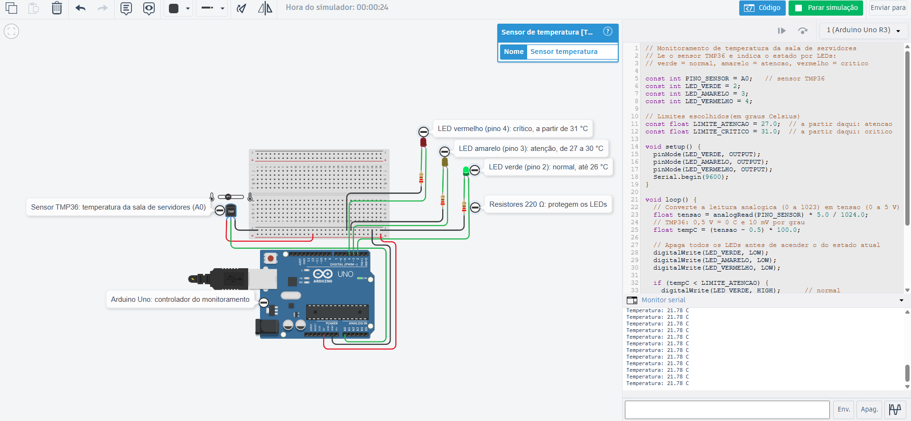
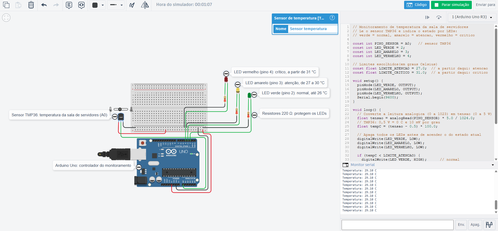
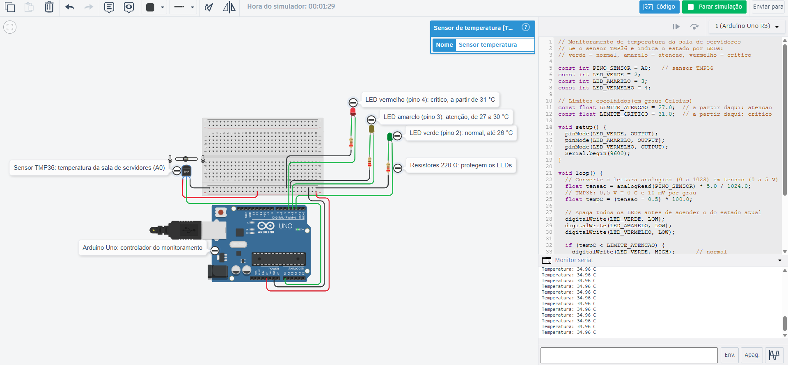

# Testes do monitoramento de temperatura (IoT)

## Objetivo
Verificar se o circuito indica corretamente o estado da temperatura da sala de servidores da BVA Tech usando três LEDs.

## Configuração
- Placa: Arduino Uno
- Sensor: TMP36 (pino A0)
- LEDs: verde (pino 2), amarelo (pino 3), vermelho (pino 4), cada um com resistor de 220 ohms
- Montagem em protoboard, simulada no Tinkercad Circuits
- Limites: normal até 26 °C, atenção de 27 a 30 °C, crítico a partir de 31 °C

## Como os testes foram feitos
Com a simulação rodando, a temperatura do sensor foi alterada pelo controle deslizante do Tinkercad. Em cada teste, registrou-se o valor aplicado, a leitura mostrada no Monitor Serial e o LED que acendeu.

## Resultados

| Teste | Entrada (controle) | Leitura no Serial | Resultado esperado | Resultado obtido | Evidência |
|---|---|---|---|---|---|
| 1: normal | 22 °C | 21,78 °C | Só o LED verde acende | Verde aceso, amarelo e vermelho apagados | teste-1-normal.png |
| 2: atenção | 29 °C | 29,10 °C | Só o LED amarelo acende | Amarelo aceso, verde e vermelho apagados | teste-2-atencao.png |
| 3: crítico | 35 °C | 34,96 °C | Só o LED vermelho acende | Vermelho aceso, verde e amarelo apagados | teste-3-critico.png |

## Observação sobre a leitura
O sensor é lido pelo conversor analógico de 10 bits do Arduino, com resolução de cerca de 0,5 °C. Por isso a leitura no Monitor Serial pode diferir ligeiramente do valor aplicado no controle (por exemplo, 34,96 °C para 35 °C). O LED responde ao valor lido, e os valores usados nos testes ficam longe dos limites, então o resultado não é afetado.

## Evidências

### Teste 1: normal (22 °C)

### Teste 2: atenção (29 °C)

### Teste 3: crítico (35 °C)

## Conclusão
O circuito respondeu como esperado nos três níveis: LED verde abaixo de 27 °C, amarelo de 27 a 30 °C e vermelho a partir de 31 °C. Com isso, a equipe de infraestrutura consegue identificar rapidamente se a sala de servidores está em condição normal, de atenção ou crítica.
