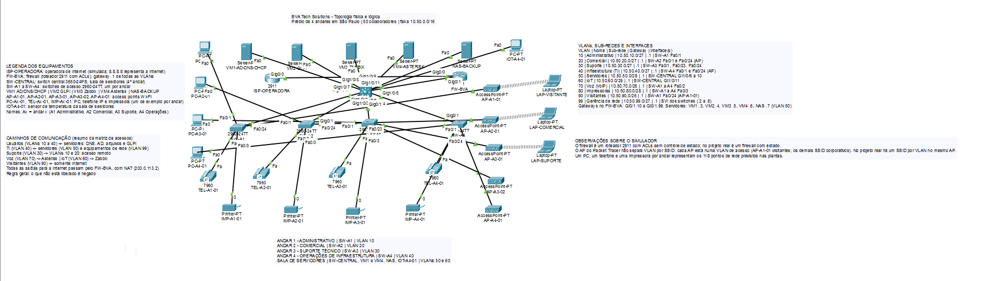

# Projeto de Infraestrutura — BVA Tech Solutions
 
## Resumo
Planejamento de infraestrutura para uma empresa fictícia de tecnologia da informação localizada em um prédio de quatro andares, com 50 funcionários. A solução reúne computadores, servidores, sistemas operacionais, redes e Internet das Coisas (IoT) para garantir eficiência, segurança e continuidade dos serviços.
 
## Organização
- 01-Empresa/: empresa, organograma e postos.
- 02-Arquitetura/: computadores, servidor, RAID, energia e orçamento.
- 03-Sistemas-Operacionais/: sistemas, serviços, permissões, backup e licenças.
- 04-Redes/: plantas, topologia, VLANs, IPv4, Wi-Fi e equipamentos.
- 05-IoT/: código, circuito e três testes.
 
## Como consultar
Comece pela pasta **01-Empresa** para conhecer a organização da BVA Tech Solutions e, em seguida, siga as pastas **02 a 05** para analisar cada etapa do projeto.
 
## Links técnicos
- Tinkercad: https://www.tinkercad.com/things/4N1m7I9Cy4r/editel?sharecode=pKS6GtOUIibWkP6sf5DJd4XyFncCQyHcdEBNkKiuk_8
- Packet Tracer: 
- Draw.io: https://drive.google.com/file/d/1GxWT1Cnco1FD8BjFTYBpNVQmVYI7-vTl/view?usp=sharing
 
## Ferramentas utilizada
- Excel
- Word
- Draw.io
- Cisco Packet Tracer
- Tinkercad
- GitHub
 
## Última atualização
 
24/11/2026
